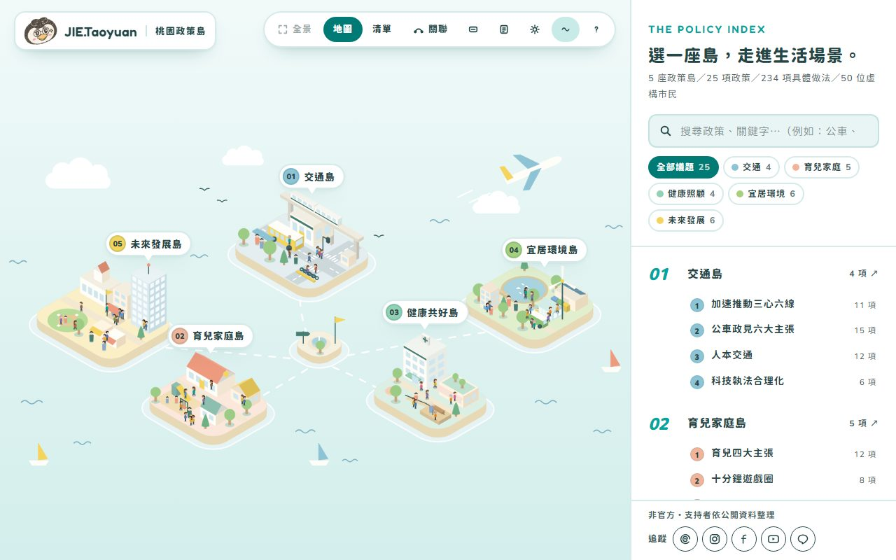
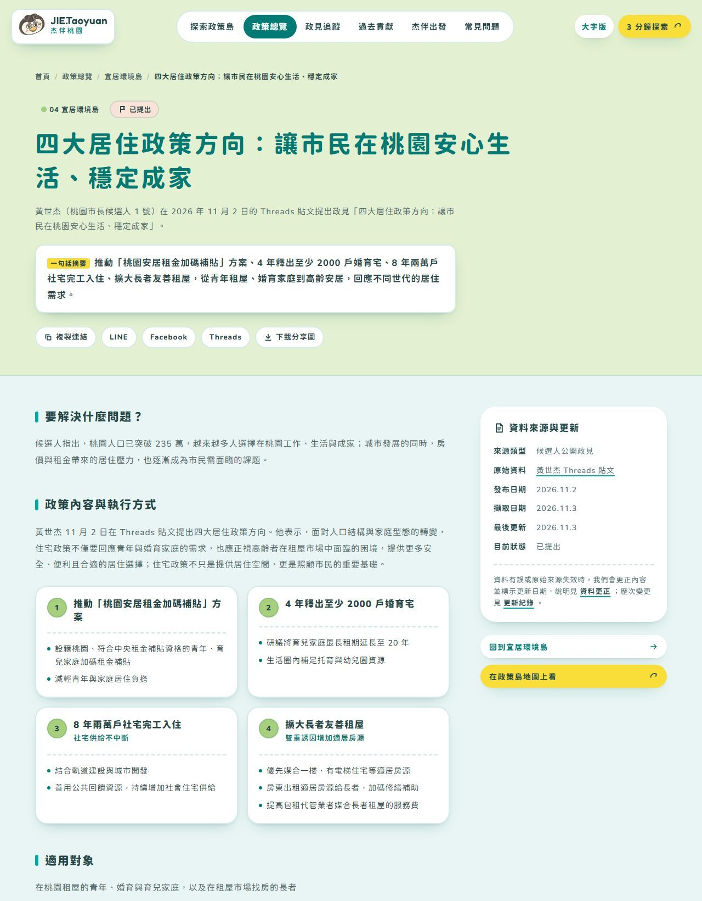
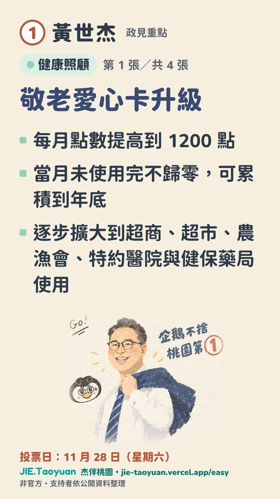
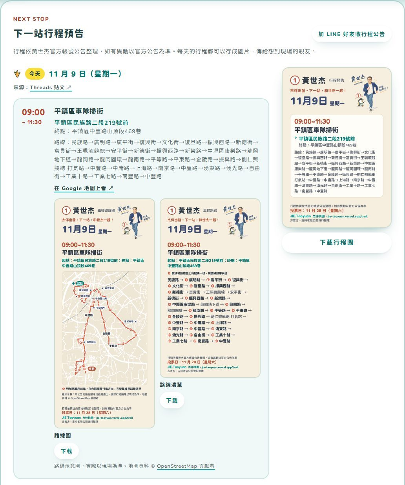
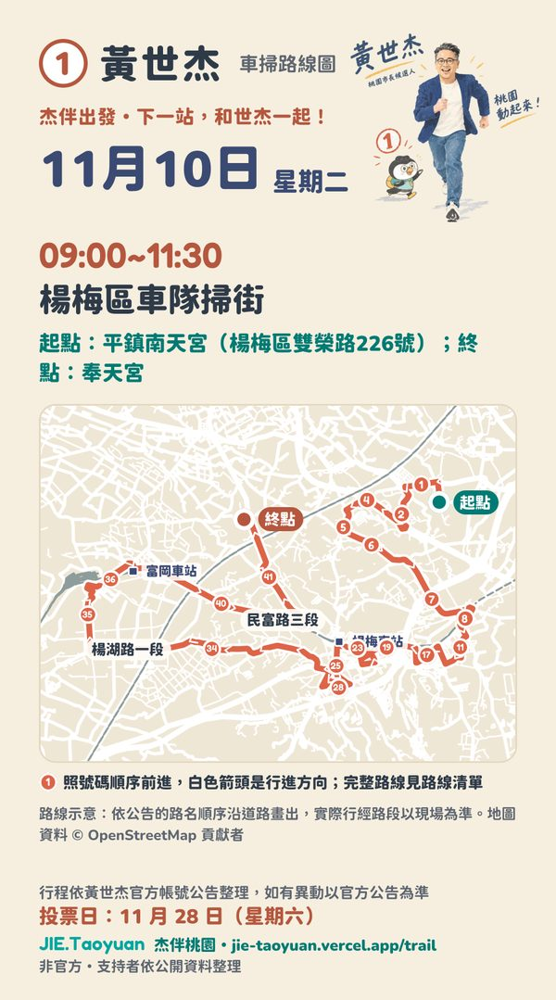
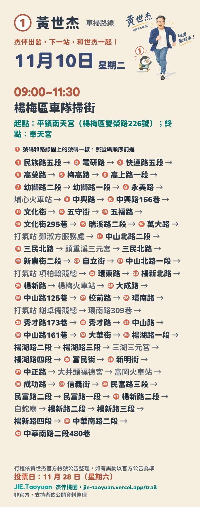
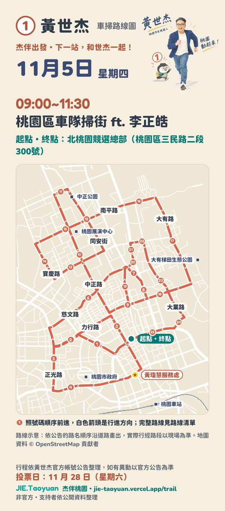
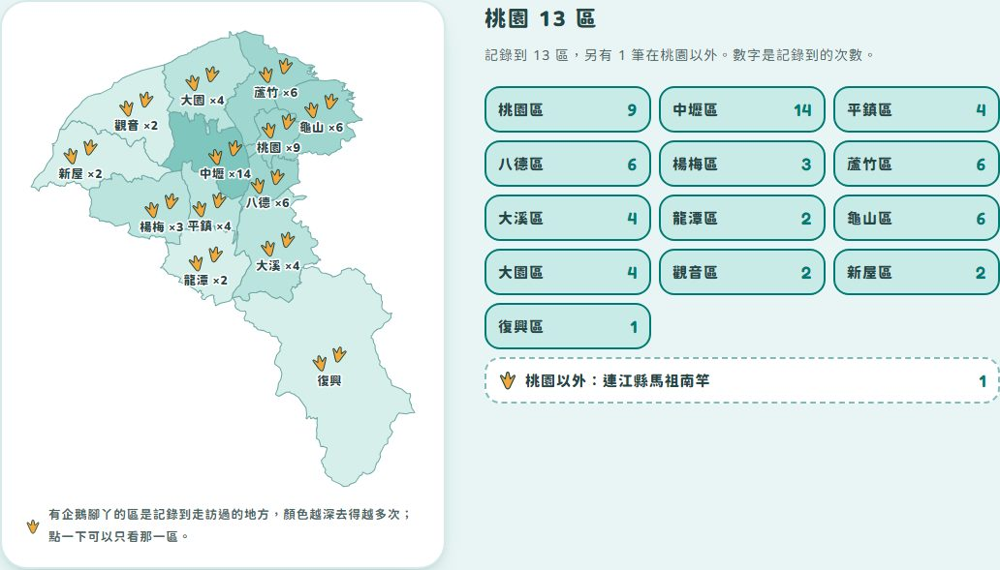

# 杰伴桃園 JIE.Taoyuan

**2026 桃園市長候選人黃世杰的政見探索網站｜支持者自發整理，非官方**

🌐 https://jie-taoyuan.vercel.app

把政見放上五座「政策島」：交通、育兒家庭、健康照顧、宜居環境、未來發展。從生活場景出發，一項一項看懂政見要解決什麼問題、提出哪些做法；每一項都附上候選人官方貼文或媒體報導，可以回到原始來源查證。


> 本站是支持者依公開資料整理的非官方網站，不是候選人或競選團隊經營。政見內容以原始來源為準。
> 畫面截於 2026 年 11 月 9 日。

---

## 功能與畫面

### 探索政策島（`/explore`）

等距插畫的全景地圖：點一座島，鏡頭拉近並標出島上每項政見；點建築或圖釘，就在地圖上打開政見重點。「關聯」模式把政策之間的關聯畫成線，島上的市民也會沿著這些關聯走動。右邊的索引可以搜尋關鍵字、依島嶼篩選；日夜依台灣時間自動切換。



### 政見頁（`/policies/…`）

每項政見分成「要解決什麼問題」「政策內容與執行方式」「適用對象」，附虛構的生活情境幫忙想像，以及「出處與查證」：來源類型、原始資料、發布與擷取日期，原文沒說清楚的地方另外標註。



### 3 分鐘探索與桃園卡（`/lab`）

選一個生活主題，挑 3 項政見收下積木，拼出一張可以分享的桃園卡。不用登入，也不填任何資料。

<p>
  
  
</p>

### 大字版（`/easy`）

給長輩看的版本：字放大、話說短，每項政見只寫 2～4 個重點。每項政見都有一張手機全螢幕大小的圖卡，可以直接用 LINE 傳給家人。

<p>
  
  
</p>

### 杰伴出發：行程預告與車隊掃街路線圖（`/trail`）

最上面是接下來的行程預告，整理自候選人 LINE 官方帳號與 Threads 的公告，只顯示今天以後的日子。每天一張行程圖卡；車隊掃街另有「路線圖」和「路線清單」兩張圖卡（地圖和文字分開，圖片不會太長），都可以直接分享或下載。



路線圖依公告的路名順序沿 OpenStreetMap 的道路畫出：號碼是行進順序，另外標出起點、終點、打氣站和車站、公園等地標；路線清單照同樣的號碼列出完整路線。

行程預告下面是車隊掃街專區：13 區哪些已經跑過、接下來要去哪裡，以及每一場的路線圖和行程紀錄。

<p>
  
  
  
</p>
<p>
  
</p>

### 杰個願望 JIE WISH（`/wish`）

「每個願望，都值得被聽見。」給世杰一句加油、對桃園許下心願、說出生活裡的問題，或提出讓生活更好的點子，還可以貼一張小企鵝貼圖。送出時系統會自動檢查，符合留言規範的直接貼上願望牆，一張張疊上去，大家可以按「認同」；攻擊、謾罵、負評、廣告和個人資料不會公開，已公開的留言可以檢舉。由杰伴桃園志工團隊整理與回覆，不是候選人或競選團隊的官方管道。


### 杰伴出發：行程地圖

已經發生的行程（走訪、活動、上節目、車隊掃街）畫在桃園 13 區地圖上：去過的區放企鵝腳丫，顏色越深去得越多次，點一區就只列那一區的行程。每一筆都附原始貼文或報導。



### 其他頁面

| 網址 | 內容 |
|---|---|
| `/policies` | 政見總覽 |
| `/progress` | 政見追蹤：依提出時間排列 |
| `/record` | 過去的貢獻：參選前的事蹟，每句引文標明出處類型 |
| `/updates` | 更新紀錄：本站每一次新增、修正、換來源都有紀錄 |
| `/faq`、`/about` | 常見問題、關於本站 |

---

## 資料原則

- **官方來源優先**：先找候選人官方帳號（Threads、YouTube、Facebook），找不到才用主流媒體報導。
- **照原文整理**：不補原文沒有的數字、時程或承諾；原文沒說清楚的另外標註「核對」「澄清」。
- **可以回到出處**：每項政見、每筆行程都附來源連結與日期，更新紀錄公開在 `/updates`。
- **不收個資**：不放聯絡信箱，網站不需要登入。杰個願望不需要留下個人資料，IP 只存成無法還原的雜湊。

---

## 技術

- [Next.js](https://nextjs.org) 16（App Router）、React 19、TypeScript、Tailwind CSS 4，部署在 Vercel，推到 `main` 自動上線。
- 頁面與分享圖都在建置時預先產生；分享圖用 `next/og`。
- 杰個願望用 Neon Postgres 存留言、Cloudflare Turnstile 做人機驗證（設定方式見維護手冊）。
- 政策島是自製的等距（isometric）SVG 插畫引擎（`web/src/lib/iso.ts`、`scene.ts`）。
- 車隊掃街路線圖由 `tools/route-map/build.py` 從 OpenStreetMap 路網產生。
- 官方新貼文由 GitHub Actions 每 3 小時偵測一次（`tools/official-watch/`），整理後再人工更新網站。

```
web/                Next.js 網站（內容資料在 web/src/data/）
tools/              偵測官方貼文、產生路線圖與行政區地圖、通知搜尋引擎
docs/screenshots/   README 用的畫面
.claude/skills/     整理官方貼文、行程預告的規則
MAINTENANCE.md      維護手冊
```

### 本機執行

```bash
cd web
npm ci
npm run dev          # http://localhost:3000
```

建置、檢查與每天的更新流程，見 **[維護手冊 MAINTENANCE.md](MAINTENANCE.md)**。

---

## 資料與素材來源

- 政見、行程內容：候選人官方帳號貼文與媒體報導（各頁附原始連結）。
- 路網與地標：© [OpenStreetMap](https://www.openstreetmap.org/copyright) 貢獻者（ODbL）。
- 桃園行政區界：內政部國土測繪中心鄉鎮市區界線（政府資料開放授權條款），經 [taiwan-atlas](https://github.com/dkaoster/taiwan-atlas) 轉換。
- 字型：Chiron GoRound TC、Fredoka（SIL Open Font License）。
